# mcd 아키텍처와 기술 설명

이 문서는 mcd가 어떻게 동작하는지, 왜 그렇게 만들었는지를 설명한다. 진행 상황과 남은 과제는 [PLAN.md](PLAN.md), 실험 수치는 [`experiments/`](../experiments)에 있다.

## 1. 무엇을 하는가

mcd는 **상시 서버 없이 친구들이 하나의 마인크래프트 월드를 공유**하게 한다.

- 플레이하려는 사람의 PC가 그때그때 Paper 서버(호스트)가 된다. 아무도 없으면 어느 PC에서도 서버가 돌지 않는다.
- 월드는 git 원격 저장소(GitHub private repo 등)에 버전으로 보관된다. 누가 다음에 호스트가 되든 최신 월드에서 이어간다.
- 사용자는 마인크래프트에서 항상 `localhost:25565`에 접속한다. mcd가 현재 호스트로 이어주고, 호스트가 없으면 그 PC를 호스트로 만든다.

이 목표에서 나오는 세 가지 핵심 문제와 해결 방식은 다음과 같다.

| 문제 | 해결 |
|---|---|
| 동시에 두 명이 호스트가 되면 월드가 갈라진다 | git의 force 없는 push를 compare-and-swap으로 쓰는 락 (3장) |
| 플레이 중에도 월드를 안전하게 공유해야 한다 | 저장을 멈춘 짧은 순간의 스냅샷 커밋 (4장) |
| 서로 다른 집의 PC가 접속해야 한다 | 로컬 중계와 내장 tailnet (5장, 6장) |

## 2. 전체 구조

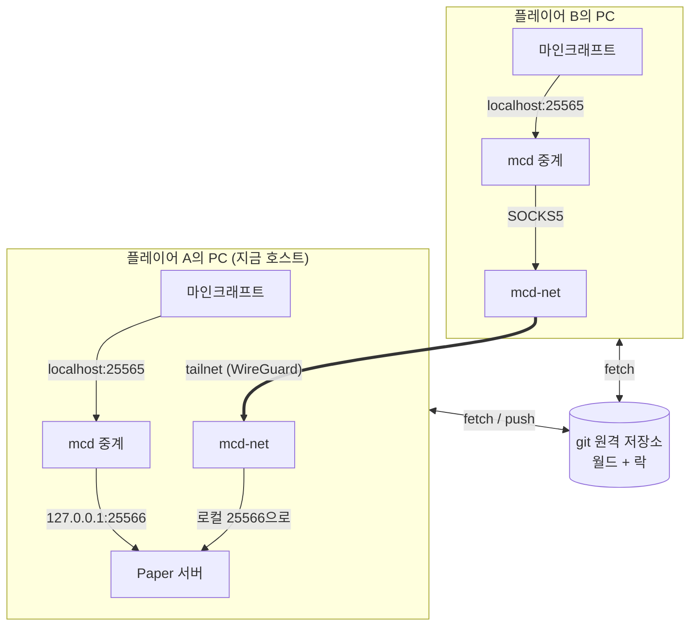

조정 서버(Tailscale 또는 Headscale)는 두 `mcd-net`이 서로를 찾고 키를 교환하는 데만 쓰인다. 게임 트래픽은 가능하면 PC끼리 직접, 안 되면 DERP 중계 서버를 거쳐 오간다.

- **git 원격 저장소**는 두 가지 역할을 한다. 월드의 보관소이자, 누가 호스트인지 정하는 락이다. 별도의 조정 서버를 두지 않는다.
- **mcd 중계**는 모든 PC에서 `localhost:25565`를 열어 두고, 연결마다 현재 호스트로 바이트를 그대로 넘긴다.
- **mcd-net**은 mcd에 들어 있는 tailnet 클라이언트다. 친구는 Tailscale을 설치하거나 로그인하지 않는다.

## 3. 소유권 프로토콜 (락)

### 3.1 git push를 CAS로 쓴다

force 없는 push는 "원격 `main`이 내가 아는 커밋일 때만 내 커밋으로 바꿔라"라는 compare-and-swap이다. 여러 노드가 같은 부모 위에 서로 다른 커밋을 만들어 동시에 push하면 **정확히 하나만 성공**한다. 로컬 bare repo 100회, GitHub 20회 실험에서 모두 그랬다([E2](../experiments/E2-results.md)). 진 쪽의 거절 사유(`failed to lock`, `cannot lock ref` 등)는 환경마다 달라서, 프로토콜은 결과가 OK인지만 본다.

**락과 월드를 같은 ref(`main`)에 둔다.** 그래서 다른 노드가 락을 가져가면 `main`이 앞으로 나가고, 락을 잃은 옛 호스트의 이후 push는 git이 거절한다. 펜싱을 git이 해주는 셈이다. force push는 어디에서도 쓰지 않는다.

### 3.2 월드 repo의 구성

작업 트리가 곧 Paper 서버 폴더다.

| 파일 | 내용 |
|---|---|
| `world/` | 월드 데이터(Paper 26.1 구조: `world/dimensions/minecraft/...`, `world/players/data/`) |
| `mcd-lock.properties` | 락: `owner`, `epoch`, `state`(FREE/HOSTING), `address`(다른 노드가 접속할 주소) |
| `mcd-paper-build.txt` | 이 월드가 쓰는 Paper 빌드(예: `26.2-133`). **앱이 아니라 월드가 버전을 정한다**(10장) |
| `mcd-network.properties` | 선택. tailnet 조정 서버 주소와 인증 키 |
| `server.properties` | `online-mode`, `region-file-compression=deflate`, `accepts-transfers=true` |
| `bukkit.yml` | `ticks-per.autosave: 0` (4장 참고) |
| `.gitignore` | `libraries/`, `versions/`, `cache/`, `logs/`, `*.jar`, `eula.txt`, `world/session.lock` 등 노드마다 다르거나 Paper가 다시 만드는 것 |

### 3.3 상태와 전이

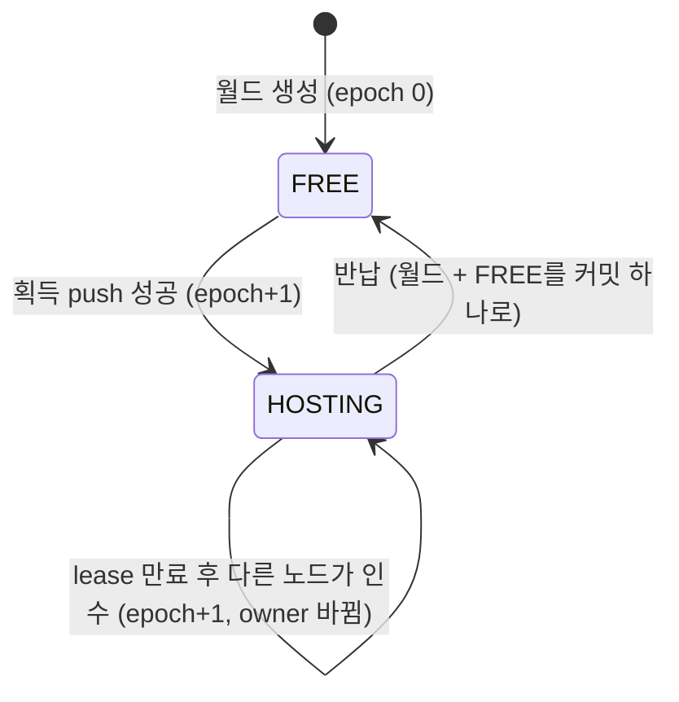

### 3.4 획득

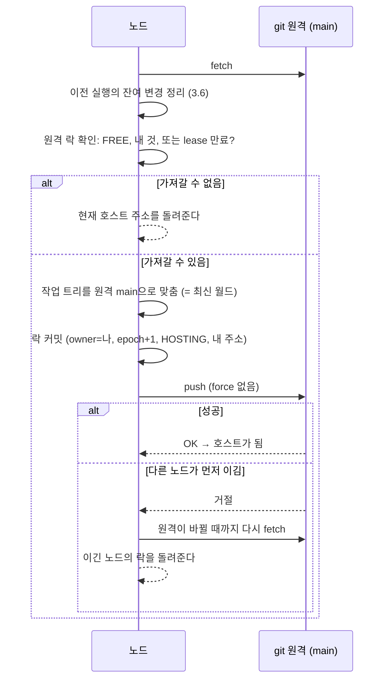

### 3.5 lease, heartbeat, 펜싱

Git lease·스냅샷 주기는 TTL(기본 10분)에서 계산한다(`Timing.fromTtl`). VPN health와 writer 실행 허가는 독립된 짧은 주기를 쓴다. Git push 빈도는 유지하고 소유권 확인에는 읽기 전용 원격 ref 조회를 쓴다.

| 값 | 계산 | 기본값 | 쓰임 |
|---|---|---|---|
| TTL | - | 10분 | lease 만료 판정 |
| heartbeat | TTL/5 | 2분 | 호스트가 락이 살아 있음을 알리는 빈 커밋 push |
| 스냅샷 | TTL | 10분 | 월드 스냅샷 push(heartbeat도 겸함) |
| 여유분 | TTL/5 | 2분 | 호스트 자진 종료 판정 |
| 관찰 주기 | TTL/20 | 30초 | 호스트가 아닌 노드의 락 확인 |
| 빈 서버 종료 | TTL/2 | 5분 | 접속자가 없으면 호스트가 스스로 반납 |

- **lease 만료는 자기 시계로만 판정한다.** "같은 `main` 커밋을 내가 관찰한 지 TTL이 지났다"면 만료다. 다른 PC의 시계와 비교하지 않으므로 시계가 틀어져도 영향이 없다.
- **호스트의 자진 종료(펜싱)**: 다른 노드는 heartbeat 커밋을 push가 *시작된* 순간부터 볼 수 있다. 그래서 호스트는 `마지막으로 성공한 push의 시작 시각 + TTL - 여유분`이 지나도록 갱신하지 못하면 스스로 서버를 내린다. 그래도 남는 틈은 3.1의 git 거절이 막는다.

새 호스트는 `GUARDED` 상태와 로컬 사본별 식별자·epoch·health 주소를 기록한다. VPN 요청은 5초 간격, 제한 2초이며 3회 실패하면 장애를 의심한다. 로그인 수요가 있으면 소유권을 Git에서 다시 확인하고 다음 epoch를 경쟁 push한다. 성공한 후보는 30초 대기한 뒤 Paper를 시작한다. 옛 `HOSTING` 상태에는 조기 인수를 적용하지 않는다.

`WriterGuard`는 별도 연결로 5초마다 원격 ref를 확인한다. 조회 시작 시각부터 최대 20초만 실행을 허가하며, Paper 내부 `ParentWatchdog`도 loopback 허가 응답을 감시한다. 소유권 변경·허가 만료 시 종료하고 종료 훅이 5초 안에 끝나지 않으면 강제 종료한다. 긴 Git push나 월드 저장이 감시를 막지 않는다. 임의의 OS/VM 정지까지 완전한 단일 Paper 실행을 보장하지 않는다.

락은 `protocol=2`를 기록하며 더 새 형식은 거부한다. 같은 표시 이름의 다른 PC는 소유자가 아니다. 같은 로컬 사본은 OS 파일 락으로 동시 실행을 막는다. 모든 참가 PC를 업데이트한 뒤 사용한다.

### 3.5.1 관리 작업

월드 교체·플러그인 변경은 `WorldAdmin`이 만든 별도 임시 clone에서 수행한다. `FREE`일 때만 `MAINTENANCE` 락을 획득하고, 이 상태에서는 플레이와 health 조기 인수를 막는다. 긴 작업 동안 빈 커밋으로 락을 갱신한다. 먼저 `backup/...` ref를 push한 뒤 검증된 파일을 적용하고, 변경 내용과 `FREE`를 하나의 커밋으로 게시한다. 실패한 부분 파일은 일반 Node recovery가 열지 않는 임시 사본에 남긴다. 백업 복구도 현재 이력 위의 새 커밋이다.

`WorldImport`는 폴더·ZIP을 별도로 준비하고 원본 session lock·버전·경로·크기를 확인한다. 기본 월드와 차원·플레이어 데이터를 교체하며 서버 설정·초대·플러그인은 유지한다. `PluginManager`는 JAR descriptor를 안전한 YAML reader로 검사하고 SHA-256을 기록한다. 호스트 시작 전에 JAR 목록·해시·필수 의존성을 검증한다. 배포 파일 목록과 실제 Paper 활성 상태는 다르며, SQLite/외부 DB를 쓰는 임의 플러그인의 데이터 정합성은 보장 범위 밖이다.

### 3.6 크래시 후 복귀와 recovery 브랜치

노드가 시작할 때(실제로는 매번 원격을 확인할 때) 이전 실행이 남긴 커밋이나 커밋하지 않은 월드 변경이 있으면 정리한다.

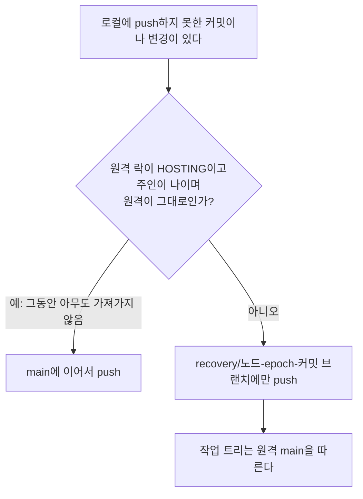

recovery 브랜치는 사람이 나중에 살펴볼 수 있도록 남기는 것이고, `main`에는 절대 섞지 않는다.

## 4. 플레이 중 스냅샷

Paper가 도는 동안 월드 파일은 계속 바뀐다. 파일이 바뀌는 도중에 커밋하면 깨진 스냅샷이 된다.

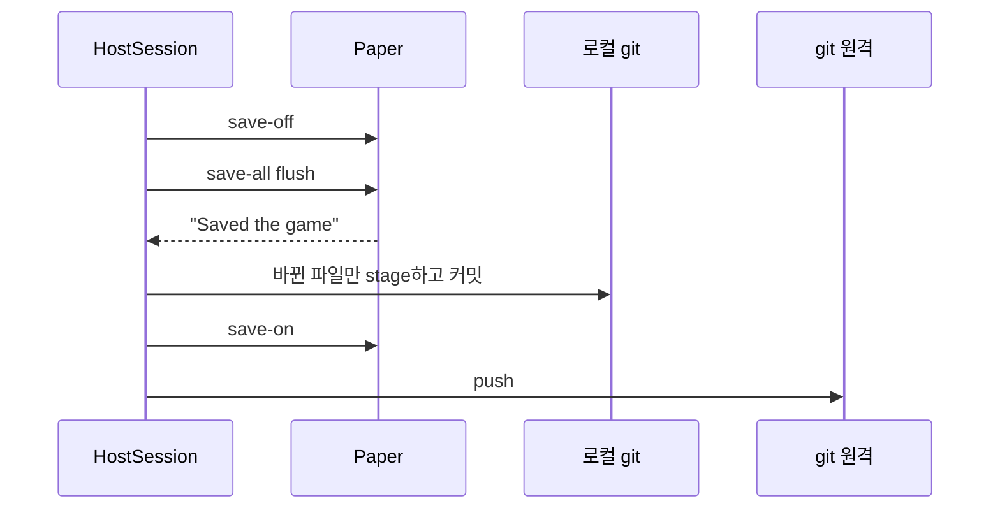

- **Paper 자동 저장은 끈다.** `save-off` 중에도 Paper 자동 저장은 `level.dat`과 `data/*.dat`을 썼다(실험 E3 1차, 20라운드 중 1회). 월드 템플릿의 `bukkit.yml`에서 끄고, 저장은 이 스냅샷이 맡는다. 끈 뒤에는 20라운드 모두 저장을 멈춘 동안 바뀐 파일이 없었다([E3](../experiments/E3-results.md)).
- **저장을 멈추는 건 커밋하는 동안뿐이다.** push는 이미 만든 git 객체를 보내는 것이라 파일이 고정될 필요가 없어서, 저장을 다시 켠 뒤에 한다.
- **바뀐 파일만 stage한다.** JGit의 `add "."`은 바뀌지 않은 파일까지 다시 읽고 압축해서 커밋 시간이 월드 전체 크기에 비례했다(0.9초 → 9.7초). `status`(크기와 수정 시각 비교)로 바뀐 파일을 찾아 그것만 stage하니 1초 안팎이 됐다. 조정에 쓰지 않은 세션으로도 확인했다([E1′](../experiments/E1-prime-results.md)).
- **저장 형식은 바꾸지 않는다.** MCA는 청크마다 따로 압축하고 바뀌지 않은 청크의 바이트가 그대로 남아서, gc 후에는 git delta가 바뀐 부분만 잡는다. 스냅샷 20개의 이력을 합쳐도 최신 월드 크기(174MB)와 거의 같았다(176MB). 텍스트(SNBT) 변환은 이득이 없다고 판단했다.

## 5. 노드와 중계

### 5.1 노드의 생명주기

`mcd play`(또는 GUI)는 계속 켜져 있는 노드다. 호스트인 동안은 `HostSession`이 git 작업 트리와 Paper를 맡고, 아닌 동안은 `Node`가 락을 관찰한다.

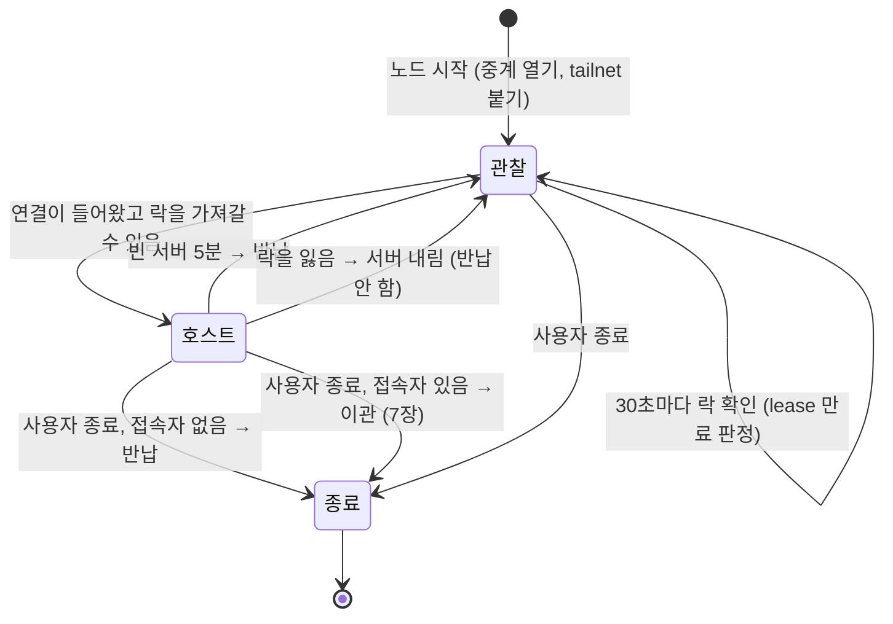

### 5.2 연결이 들어왔을 때 (`Node.route`)

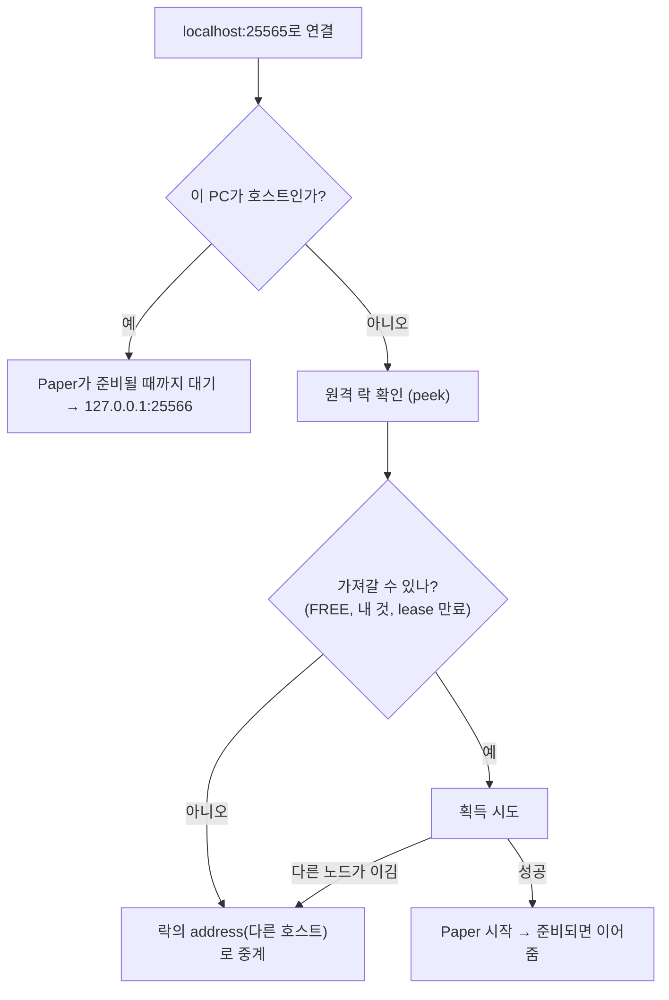

- Paper 기동은 최대 3분까지 기다린다. 그동안 중계가 클라이언트를 붙잡아 둔다(5.3).
- **Paper 패치는 노드를 열 때 미리 한다.** 새 폴더의 첫 기동은 Paperclip이 Mojang jar를 받고 패치하느라 평소보다 20초쯤 더 걸린다(26.2-133에서 패치만 16.9초). 이관은 그 월드를 처음 호스트하는 PC로 넘어가는 일이 많아서, `Node.open`이 `-Dpaperclip.patchonly=true`로 패치만 해 둔다. 이미 해 뒀으면 0.6초라 매번 실행하고, 결과물(`cache/`, `libraries/`, `versions/`)은 `.gitignore` 대상이다. 미리 하지 못하면(네트워크 등) 경고만 남기고, Paper가 기동하면서 다시 한다.
- **획득은 `tryAcquire` 한 번으로 한다.** 가져갈 수 없으면 현재 락만 돌려주므로 `peek`를 먼저 하지 않는다. 접속마다 원격 fetch가 한 번 줄어든다.
- 이관 시간을 구간별로 보도록 락 획득, Paper 기동, 넘기기 전 저장과 push에 걸린 시간을 로그에 남긴다.

### 5.3 중계 (`Relay`)

- 연결 첫머리(핸드셰이크와 로그인 시작)만 읽고, 호스트에 연결되면 그 패킷을 그대로 다시 보낸 뒤 **바이트를 그대로** 넘긴다. 첫머리는 압축도 암호화도 되지 않은 구간이고, 암호화와 정품 인증은 그 뒤에 클라이언트와 Paper 사이에서 그대로 이뤄진다(`Protocol`).
- **서버 목록 확인(ping)은 호스트를 띄우지 않는다.** 마인크래프트의 멀티플레이 화면은 목록의 서버들에 주기적으로 상태를 묻는다. 이것까지 접속으로 처리하면 목록을 여는 것만으로 서버가 뜬다(v0.1.0의 문제). 핸드셰이크의 의도가 상태 확인이면, 살아 있는 호스트가 있을 때는 그쪽으로 넘기고 없을 때는 중계가 직접 "접속하면 서버가 시작됩니다"로 답한다. 서버 목록은 자주 확인하므로 git을 보지 않고 관찰해 둔 락 상태를 쓴다.
- **로그인은 호스트가 준비될 때까지 붙잡아 둔다.** 클라이언트는 30초 동안 받은 데이터가 없으면 끊는다. 중계는 기다리는 동안 5초마다 로그인 플러그인 질의(`mcd:wait`)를 보낸다. 클라이언트는 모르는 질의에 "모름"으로 답하고 계속 기다린다. 이 답은 Paper에 넘기면 안 되므로, 연결되면 질의를 멈추고 보낸 만큼 답을 읽어서 버린 뒤 첫머리를 다시 보낸다. lazymc 같은 기존 도구는 이 대기를 25초로 제한했는데(그 뒤로는 빈 가짜 월드에 넣는 방식), 이 방법은 **정품 클라이언트(26.1.2, online mode)로 약 35초 걸린 첫 기동을 끊김 없이 통과했다**(2026-10-11). 같은 시험에서 중계를 거친 정품 인증도 확인했다.
- 호스트에 연결하지 못하면 시간 초과 대신 이유가 적힌 끊김 메시지를 보낸다.
- 다른 PC에서 들어오지 못하도록 loopback 주소에만 연다.
- 목적지가 loopback이 아니면(다른 호스트) tailnet의 SOCKS5를 거쳐 나간다.
- 호스트가 막 바뀐 직후에는 새 호스트의 Paper가 아직 기동 중일 수 있어서, 연결이 거절되면 다시 시도한다(그동안 클라이언트는 붙잡혀 있다).
- **스레드 모델**: 중계는 플랫폼 스레드를 쓴다. Windows에서 가상 스레드로 소켓을 중계하면 가끔 읽을 데이터가 있는데도 깨어나지 않아 연결이 멈췄다(40회 중 3~4회, 스레드 덤프로 확인). 연결 수는 플레이어 수 정도라 플랫폼 스레드로 충분하다.

## 6. 네트워크 (tailnet 내장)

서로 다른 집의 PC는 NAT 뒤에 있어서 직접 접속할 수 없다. 오픈소스 VPN도 결국 공인 IP가 있는 중개 노드나 조정 서버가 필요하다. mcd는 Tailscale의 Go 라이브러리 **tsnet**으로 만든 보조 프로그램 `mcd-net`을 내장한다([E5](../experiments/E5-results.md)).

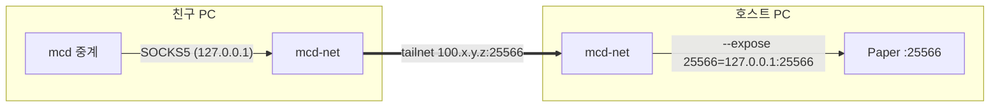

- mcd가 `mcd-net`을 자식 프로세스로 띄운다. `mcd-net`은 준비되면 `READY <tailnet IP> <SOCKS 주소>`를 출력하고, mcd가 끝나 stdin이 닫히면 같이 끝난다.
- 월드 repo의 `mcd-network.properties`가 있으면 켜진다. 월드 주인이 인증 키를 한 번 넣으면 친구들은 clone할 때 같이 받는다.
- 락의 `address`에는 호스트의 tailnet 주소가 적힌다.
- 노드 키 같은 tailnet 상태는 월드 폴더(git 작업 트리) 밖, `<cache>/../tailnet/`에 둔다. 월드 폴더에 두면 커밋될 수 있다.
- 조정 서버는 기본으로 Tailscale을 쓰고, Headscale 같은 다른 서버도 쓸 수 있다. 개발 테스트는 Headscale을 써서 계정 없이 한다.

### 6.1 GitHub 접근: deploy key와 초대 코드

친구가 GitHub 계정 없이 참가하도록, 월드 repo마다 그 repo 하나에만 쓰는 SSH **deploy key**를 둔다([E9](../experiments/E9-results.md)).

- 키는 mcd가 만든다(`DeployKey`, ECDSA P-256. ed25519는 MINA sshd 2.x에서 추가 라이브러리가 필요하다). 월드 주인이 GitHub 웹의 Deploy keys 화면에서 쓰기 권한으로 한 번 등록한다. **토큰으로 자동 등록하지 않는다**: 토큰으로 만든 deploy key는 그 토큰을 지우면 함께 지워진다(GitHub 문서). 같은 이유로 새 월드도 사용자가 웹에서 만든 빈 repo에 올린다.
- 등록이 끝나면 mcd가 그 키로 push 연결을 열어 본다(`WorldRepository.checkWriteAccess`). 키가 없거나 읽기 전용이면 여기서 알린다.
- 초대 코드는 `mcd1.` + repo(계정/이름) + 키다(`Invite`, 300자 안쪽). 코드를 가진 사람은 누구나 월드를 읽고 쓸 수 있다. 초대를 끊으려면 키를 지우고 새로 만든다.
- 접속은 `ssh://git@ssh.github.com:443/<계정>/<repo>.git`(22번 포트를 막는 네트워크 대비), JGit `ssh.apache`. `~/.ssh`를 읽지 않고, 서버 키는 GitHub가 공개한 SHA256 지문과만 비교한다.
- 인증은 JGit `TransportConfigCallback` 하나로 넘긴다. 월드에 키가 있으면 SSH, 없으면 설정의 토큰(https, 예전 방식). 같은 repo를 https에서 SSH로 바꾸면 작업 트리의 원격 주소도 따라 바꾼다.
- SSH로도 force 없는 push는 CAS로 동작한다(E9, 20회 모두 승자 하나). 다만 명령마다 연결을 새로 맺어 push가 https보다 약 1.1초 느리다.

## 7. 호스트 이관

다른 사람이 접속해 있는데 호스트가 나가면 서버를 넘긴다.

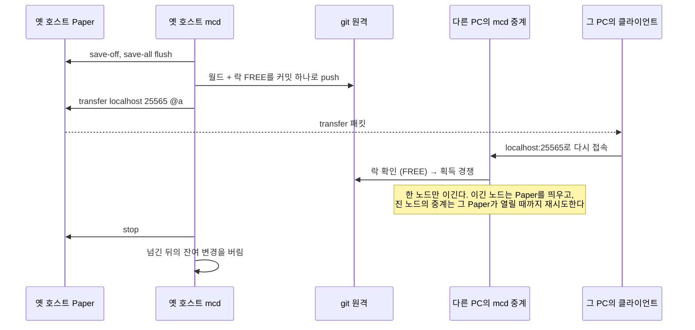

- transfer는 1.20.5부터 바닐라에 있는 기능이다. 대상 주소 `localhost`는 각 클라이언트의 *자기 PC*로 풀리므로, 모두에게 같은 명령 한 줄이면 각자의 중계로 돌아간다.
- 기존 서버에서 플레이어가 곧바로 빠지므로, 처음 계획했던 읽기 전용 구간(adventure 모드, `tick freeze`)이 필요 없다.
- **저장을 끈 뒤 반납 push가 끝날 때까지(5~7초)는 플레이어를 얼린다.** 이 동안의 플레이는 넘긴 월드에 들어가지 않는다(실측에서 그동안 쌓은 블록 8개가 사라졌다). 넘기기 전에 스냅샷을 먼저 올리거나 thin pack으로 보내는 양을 줄여도, region 파일이 바뀐 push는 크기와 상관없이 3.5~4.5초가 걸려서 이 구간이 줄지 않았다([E7](../experiments/E7-results.md)). 그래서 구간을 줄이는 대신 그동안 아무것도 할 수 없게 한다: flush 직후 모든 플레이어의 `movement_speed`, `jump_strength`, `block_interaction_range`, `entity_interaction_range` 기본값을 0으로 하고 제목을 띄운다. 저장을 끈 뒤의 변경이라 넘긴 월드에는 남지 않는다(`HandoffScenarioTest`가 확인). 반납에 실패해 이 서버에서 계속하면 기본값으로 되돌린 뒤 저장을 다시 켠다. 인벤토리 안에서 아이템을 옮기는 정도는 막지 못하지만 저장 시점으로 돌아갈 뿐이다.
- 넘긴 뒤 기존 서버가 종료하면서 쓴 파일(플레이어가 나가며 저장된 데이터 등)은 이미 넘긴 스냅샷보다 뒤의 것이라 버린다. 남기면 다음 실행 때 recovery 브랜치가 쓸데없이 생긴다.
- 나가는 PC의 플레이어는 같이 끊긴다. 그 PC의 사용자가 나가는 것이라 자연스럽다.

## 8. 장애 처리

| 상황 | 동작 |
|---|---|
| 두 노드가 동시에 호스트가 되려 함 | push CAS로 하나만 이긴다. 진 쪽은 이긴 쪽으로 중계한다 |
| 호스트 PC가 갑자기 꺼짐 | health 연속 실패 후 로그인 수요가 있으면 다음 epoch를 경쟁 push하고 30초 뒤 시작한다. 옛 호스트는 TTL로 인수한다. 마지막 공유 스냅샷으로 이어진다 |
| 꺼졌던 옛 호스트가 다시 켜짐 | push하지 못한 변경은 recovery 브랜치로만 간다. `main`은 갈라지지 않는다 |
| mcd만 죽음 | Paper는 stdin이 닫혀도 계속 돌기 때문에, Paper JVM에 붙인 Java 에이전트(`ParentWatchdog`)가 부모(mcd)의 종료를 감지해 Paper를 정상 종료시킨다. 다시 켜면 자기 락을 다시 잡고 그 플레이 기록을 이어 올린다 |
| Paper가 비정상 종료 | 쓰다 만 월드 파일을 믿을 수 없으므로 락만 반납한다(마지막 스냅샷까지만 공유). 남은 변경은 다음 실행 때 recovery로 간다 |
| 호스트가 원격 저장소에 닿지 못함 | 별도 원격 확인으로 실행 허가를 갱신한다. 20초간 확인하지 못하면 Paper를 내린다 |
| 호스트가 락을 잃음(push 거절) | 즉시 서버를 내리고 반납하지 않는다 |
| Ctrl+C | Windows에서는 Paper에도 전달된다. Paper는 저장하고 끝나며, 종료를 요청한 경우이므로 정상 반납한다 |
| 엉뚱한 git repo를 월드로 엶 | `mcd-paper-build.txt`가 없으면 아무것도 쓰기 전에 거부한다 |

## 9. 모듈 구성

| 패키지 | 책임 | 주요 클래스 |
|---|---|---|
| `mcd.lock` | 소유권 프로토콜 | `HostLock`(획득, heartbeat, 스냅샷, 반납, 펜싱, 복귀), `LockState` |
| `mcd.node` | 한 PC의 노드 | `Node`(중계, 라우팅, 관찰, tailnet), `HostSession`(Paper, heartbeat, 스냅샷, 빈 서버 종료, 이관), `Timing` |
| `mcd.node` | 짧은 writer 실행 허가 | `WriterGuard`(원격 소유권 확인, loopback 허가), `ExecutionPermit`(단조 시간 만료) |
| `mcd.net` | 네트워크 | `Relay`(중계, 서버 목록 응답, 로그인 붙잡기), `Protocol`(첫머리 패킷), `Tailnet`(`mcd-net` 실행과 SOCKS5) |
| `mcd.server` | Paper 제어 | `PaperServer`(프로세스, 콘솔 명령, 저장 제어), `PaperDistribution`(월드가 정한 빌드 다운로드, 해시 검증, 지원 범위), `PaperBuild`, `ParentWatchdog`(Java 에이전트) |
| `mcd.world` | 월드 repo | `WorldRepository`(생성, clone, 쓰기 권한 확인), `WorldTemplate`(초기 파일), `NetworkConfig`, `DeployKey`, `GitHubRepo`, `Invite` |
| `mcd.world` | 관리 작업 | `WorldAdmin`(관리 락·백업·복구), `WorldImport`, `LevelMetadata`, `PluginManager`, `SafeFiles`, `WorldProcessLock` |
| `mcd.cli` | CLI | `Main`, `InitCommand`, `PlayCommand`, `UpgradeCommand`, `UpdateCommand` |
| `mcd.gui` | GUI | `App`, `MainWindow`(월드 고르기·추가·빼기·버전 올리기·친구 초대), `AccountDialog`(이름, 토큰(선택), 서버 주소), `AddWorldDialog`(새 월드/참가), `DeployKeyDialog`(키 등록 안내와 확인), `StatusPanel`(상태 카드, `Node.status()`를 1초마다), `Theme`(FlatLaf, Windows 라이트/다크를 따름) |
| `mcd.update` | 자동 업데이트 | `Updater`(릴리스 확인, 받기, 검증, 교체 스크립트), `AppVersion`, `Json`(작은 JSON 파서) |
| `mcd.config`, `mcd.github` | GUI 지원 | `Settings`(`~/.mcd/settings.properties`, 공통 설정과 월드 목록, 월드별 deploy key), `GitHubClient`(토큰 확인) |
| `net-helper/` (Go) | tailnet 보조 프로그램 | `mcd-net`: tsnet, SOCKS5, 들어오는 포워딩 |

의존 방향은 `cli`/`gui` → `node` → `lock`, `net`, `server`, `world`이다. `lock`은 JGit에만 의존하고 Paper나 네트워크를 모른다.

## 10. 배포

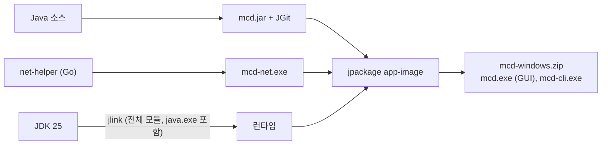

- 사용자는 Java를 설치하지 않는다. 같은 런타임으로 Paper도 띄운다.
- jpackage는 기본적으로 런타임에서 `java.exe`를 빼지만 mcd는 그 런타임으로 Paper를 띄워야 해서, 런타임을 jlink로 직접 만든다. JDK 25에는 jmods가 없어서 `java --list-modules`로 모듈 목록을 받고, 런타임 이미지 링크에서 넣을 수 없는 `jdk.jlink`는 뺀다.
- **Paper 버전은 앱이 아니라 월드가 정한다.** 월드는 새 버전으로 한 번 열리면 되돌릴 수 없어서 한 월드의 모든 호스트가 같은 빌드를 써야 하고, 그룹마다 원하는 버전이 다를 수 있기 때문이다. 앱은 월드의 `mcd-paper-build.txt`에 적힌 빌드를 Paper 다운로드 API(fill v3)에서 받아, API가 알려주는 SHA-256으로 검증하고 `~/.mcd/cache/paper-<빌드>.jar`로 보관한다. 검증한 해시는 옆에 `.sha256`으로 남겨서 두 번째부터는 네트워크 없이 확인한다. Paper jar는 배포판에 넣지 않는다.
- **지원 범위**: 1.20.5 미만은 거부한다(transfer가 없음). 그 버전의 Paper가 요구하는 Java가 앱에 들어 있는 런타임보다 새것이면 앱 업데이트를 안내한다(Paper도 같은 런타임으로 돈다). 확인한 버전(26.1.x, 26.2.x) 밖이면 경고만 하고 진행한다. mcd가 기대는 콘솔 명령과 로그 문구(`save-off`, `Saved the game`, `Done (`, `There are N of a max`, `transfer`)가 버전마다 바뀔 수 있기 때문이다. 새 월드는 26.2-133으로 만든다(`init --paper`로 바꿀 수 있다). 26.1.2는 Paper 지원이 끝났다(2026-07-26).
- **새 버전 확인**: 테스트 봇이 26.1까지만 지원해서, 새 버전은 `PaperCompatibilityTest`(봇 없이 실제 Paper로 콘솔 동작과 26.1.2 월드 업그레이드 확인)와 정품 클라이언트 접속으로 확인한다. 26.2-133은 둘 다 통과했다(2026-10-11, 첫 기동 32초 붙잡기, 정품 인증, 몇 분 플레이). 호스트 이관도 한 PC의 노드 두 개(A의 넘김 포트를 B의 중계로)와 정품 클라이언트로 확인했다. A를 끄고 35초 만에 같은 위치로 B에 들어갔고 recovery 브랜치는 생기지 않았다.
- **월드 업그레이드**: `mcd upgrade-paper`가 락을 잡고 버전 파일을 바꾼 뒤 반납한다. 호스트가 있는 동안에는 할 수 없고, 다운그레이드는 거부한다. 다음 호스트가 새 빌드로 월드를 열면서 월드 파일이 업그레이드된다.
- GraalVM native-image는 쓰지 않는다. Paper가 JVM을 필요로 해서 런타임을 뺄 수 없고, 얻는 것은 런처 시작 속도 정도다.
- 설치 파일(.msi)은 WiX Toolset이 필요해서 아직 만들지 않는다.

### 자동 업데이트

같은 월드를 쓰는 친구들의 mcd 버전이 다르면 락 형식이나 중계 동작이 어긋날 수 있어서, 앱이 스스로 업데이트한다(v0.2.0부터).

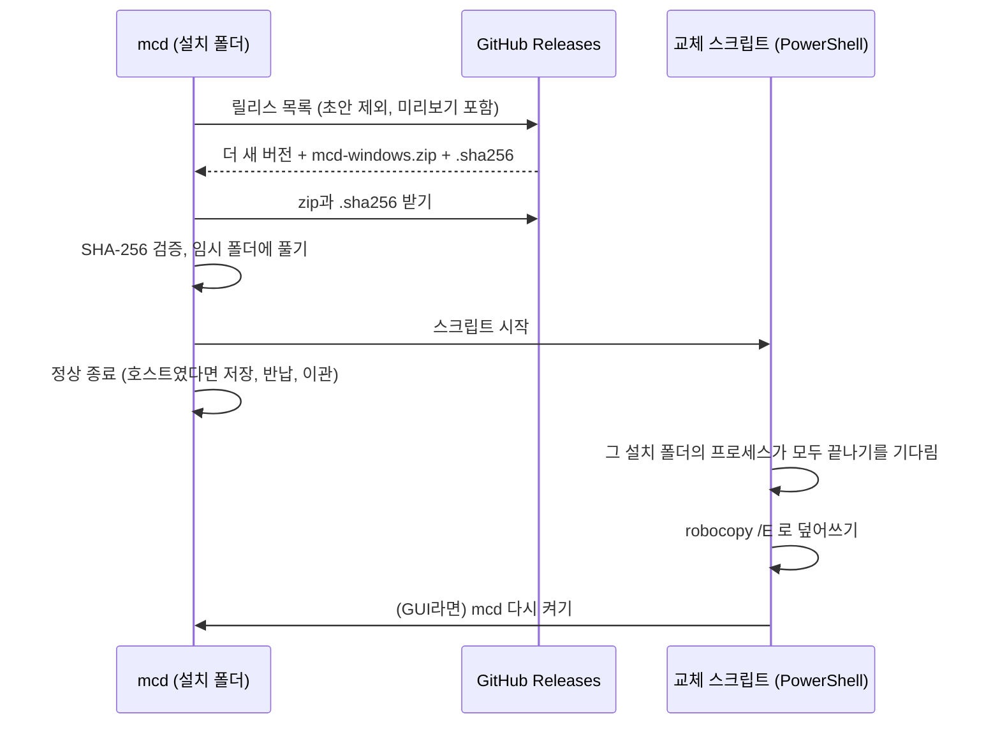

- 앱 버전은 jar manifest의 `Implementation-Version`(Gradle의 `version`)이고, 릴리스 태그(`v0.2.0`)와 비교한다.
- 실행 중인 exe, jar, Java 런타임은 Windows에서 덮어쓸 수 없어서 별도 스크립트가 mcd가 끝난 뒤에 바꾼다. PowerShell은 Windows에 기본으로 있다.
- 사용자가 설치 폴더에 둔 다른 파일을 지우지 않도록 `/MIR`이 아니라 `/E`로 복사한다. 옛 jar가 남아도 `mcd.cfg`가 정확한 목록을 쓴다.
- 해시와 zip이 같은 곳(GitHub)에서 오므로 다운로드가 깨지지 않았는지만 보장한다. 누가 만든 파일인지는 코드 서명이 있어야 보장할 수 있다.

## 11. 테스트 전략

| 층 | 무엇을 | 어떻게 | 실행 |
|---|---|---|---|
| 단위 | 소유권 프로토콜: 경쟁, 만료, heartbeat, 펜싱, 크래시 복귀, recovery | 진짜 로컬 bare repo + 주입한 가짜 시계 | `./gradlew test` |
| 단위 | 중계, 설정, GitHub 클라이언트, 월드 오인 방지 | 에코 서버, 로컬 HTTP 서버 | `./gradlew test` |
| 통합 | push CAS(로컬, GitHub), 플레이 중 스냅샷 일관성 | 실제 git, 실제 Paper | `./gradlew test`, `paperTest` |
| E2E | P0 시나리오 5개, mcd 크래시, transfer, tailnet, 이관 | 노드는 별도 JVM 프로세스, 플레이어는 Mineflayer 봇(offline mode). 봇이 26.1까지만 지원해서 26.1.2 월드로 돈다 | `./gradlew paperTest` |
| 호환성 | 새 Paper 빌드에서 mcd가 기대는 콘솔 동작, 이전 빌드 월드의 업그레이드 | 실제 Paper, 봇 없음 | `paperTest --tests '*PaperCompatibilityTest*' -Dmcd.paperBuild=<빌드>` |
| 실험 | 저장 형식, 커밋 비용, 네트워크 | 기록한 세션 재생, VM(`mcd-friend`) + Headscale | `experiments/*.md` |

- 봇은 각 노드의 중계(`localhost`)에만 접속한다. 실제 플레이어와 같은 경로다.
- Mineflayer는 서버 transfer 패킷을 처리하지 않아서, `e2e/bot.js`가 패킷을 받으면 그 주소로 다시 접속하게 직접 구현했다.
- 버그를 고칠 때는 테스트가 실제로 그 버그를 잡는지, 코드를 일부러 망가뜨려 확인했다(mutation 확인).
- 성능이나 일반화 주장은 조정에 쓰지 않은 데이터로 확인했다(E1′의 검증용 세션).

## 12. 주요 설계 결정

| 결정 | 이유 | 근거 |
|---|---|---|
| git 원격을 월드 보관소이자 락으로 | 상시 서버 없이 원자적 소유권을 얻는다. GitHub 같은 무료 호스팅을 그대로 쓴다 | E2 |
| 락과 월드를 같은 ref에 | 락을 잃은 호스트의 push를 git이 거절한다(펜싱) | 검토 에이전트 지적 후 변경 |
| lease를 자기 시계로만 판정 | PC 간 시계 차이에 영향받지 않는다 | |
| JGit | 사용자가 git을 설치하지 않는다. push 결과를 코드로 받는다 | |
| Paper 버전은 월드가 정함 | 한 월드의 모든 호스트가 같은 빌드를 써야 하고(다운그레이드 불가), 그룹마다 원하는 버전이 다르다. 앱을 다시 배포하지 않고 버전을 올릴 수 있다 | |
| Paper 자동 저장 끄기 | `save-off` 중에도 레벨 데이터를 써서 스냅샷이 흔들린다 | E3 |
| 바뀐 파일만 stage | JGit `add "."`의 비용이 월드 크기에 비례한다 | E1′ |
| 저장 형식은 그대로 | gc 후 이력 비용이 거의 없다 | E1′ |
| 주소는 항상 `localhost:25565` | 호스트가 바뀌어도, 네트워크 방식이 바뀌어도 사용자는 그대로다 | E6 |
| 첫머리만 읽는 중계 | 서버 목록 확인과 로그인을 구분하고 로그인을 붙잡을 수 있으면서도, 그 뒤로는 바이트를 그대로 넘겨 정품 인증을 건드리지 않는다 | E6, `FirstJoinHoldTest` |
| tsnet 내장 | 친구는 설치나 로그인 없이 NAT 너머로 연결된다 | E5 |
| transfer로 즉시 이관 | 읽기 전용 구간 없이 이관이 단순해진다 | M3 |
| 스트림 읽기와 중계는 플랫폼 스레드 | 가상 스레드에서 캐리어 고정(CPU 2개 PC)과 Windows 소켓 깨우기 누락이 실제로 일어났다 | E5, M3 |

## 13. 알려진 한계

- tailnet 인증 키, GitHub 토큰, deploy key의 보관 방식(월드 repo, 설정 파일 평문)은 아직 단순하다.
- 넘기는 동안 플레이어를 얼려도 날기는 막지 못한다(비행 속도는 속성이 아니라 능력치라 콘솔로 바꿀 수 없다). 블록은 다룰 수 없고 이동은 넘어가지 않으므로 잃는 것은 없다.
- tailnet으로 들어온 플레이어는 Paper에 127.0.0.1로 보인다(IP 차단 기능은 쓸 수 없다).
- 실제 원격 친구 환경으로는 아직 확인하지 않았다(VM과 봇으로 확인). 정품 클라이언트로는 한 PC에서 중계, 정품 인증, 첫 기동 대기를 확인했다.
